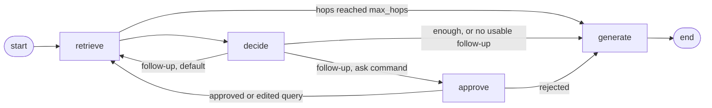

# hotpot-rag-agent

A two-hop [LangGraph](https://langchain-ai.github.io/langgraph/) agent for
multi-hop **HotpotQA** questions, built on the dense + rerank pipeline of
[rag-eval-harness](../rag-eval-harness) (bge-m3, bge-reranker-v2-m3,
`gpt-4o-mini`) and evaluated with that harness on the same 200 questions. The
answer to the question it was built for: on `gpt-4o-mini` the agent is **not
significantly better** than the single-step pipeline (EM 0.520 against 0.500)
and **does not beat** single-step `gpt-4o` (0.550), at about **7x lower formula
cost** than `gpt-4o`. A second search helps on bridge questions where the model
can name the bridge entity, hurts when the merge rule pushes a gold paragraph
out of the context, and does nothing on comparison questions.

## How it works



`approve` exists only in the interactive `ask` command. The batch run goes
straight from `decide` back to `retrieve`.

- **retrieve** runs the harness retriever (dense search, top-30 cross-encoder
  rerank) and keeps the top 10 titles per query.
- **decide** shows the model the current context and the question and asks for
  JSON `{"enough": bool, "follow_up": str}`. If a fact is missing and the
  passages name the entity it is about, the follow-up is a short query naming
  that entity and the missing attribute. An invalid reply (bad JSON, a
  refusal) means *answer now*; it is counted as a fallback and never cached.
  A follow-up that repeats an earlier query also means answer now.
- **merge rule**: with two hops the context is the top 3 of hop 1 plus the 2
  best titles from hop 2 not already taken, inside the same 5-paragraph budget
  as the single-step baseline. If hop 2 adds fewer than two, the rest of hop 1
  fills the budget.
- **max_hops = 2** by default (`--max-hops`, 1 to 5). With `--max-hops 1` the
  agent is the baseline: all 200 records are identical to `dense_rerank_200`
  with zero paid calls (`scripts.same_records`).
- **Caches**: reranker scores are reused from the harness; `decide` replies are
  cached by prompt in `data/decide_cache`, so a repeated run is free.
- **Human review** (`ask`): `interrupt()` before the second search lets a
  person approve, edit or reject the follow-up; state is kept in a SQLite
  checkpoint and deleted after the answer.

Decide prompt: v1, final. A revised prompt did worse on the 25 dev questions and
was reverted; nothing was tuned after that.

## Results

Same 200 HotpotQA validation questions as the harness (seed 42, 1990
paragraphs), `gpt-4o-mini` at temperature 0 unless noted. The second hop was
taken on 80 of 200 questions (40%); `decide` fell back on 0 of 200.

**Why a held-out 175.** The decide prompt was chosen on 25 dev questions (the
first 20 plus 5 questions the baseline had lost). Dev inflated the effect: on
the 175 questions left it is about half of what the 200 shows. Take the
numbers from the held-out table.

| 200 questions | EM | F1 | recall@5 | all_gold@5 |
|---|---|---|---|---|
| dense + rerank, `gpt-4o-mini` | 0.500 | 0.668 | 0.943 | 0.885 |
| dense + rerank, `gpt-4o` | 0.550 | 0.722 | 0.943 | 0.885 |
| **agent, `gpt-4o-mini`** | 0.520 | 0.687 | 0.958 | 0.915 |

| Held-out 175 | EM | F1 | recall@5 | all_gold@5 |
|---|---|---|---|---|
| dense + rerank, `gpt-4o-mini` | 0.509 | 0.693 | 0.951 | 0.903 |
| dense + rerank, `gpt-4o` | 0.554 | 0.739 | 0.951 | 0.903 |
| **agent, `gpt-4o-mini`** | 0.520 | 0.699 | 0.960 | 0.920 |

Paired differences, agent minus baseline (mean per question, 95% bootstrap
interval, exact sign test; the statistics are the harness's `rag_eval.compare`):

| Set | vs | Metric | Difference | 95% interval | p |
|---|---|---|---|---|---|
| 200 | mini | all_gold@5 | +0.030 | [-0.000, +0.065] | 0.146 |
| 200 | mini | EM | +0.020 | [-0.005, +0.050] | 0.289 |
| 200 | `gpt-4o` | EM | -0.030 | [-0.085, +0.020] | 0.345 |
| 200 | `gpt-4o` | F1 | -0.035 | [-0.085, +0.014] | 0.302 |
| 175 | mini | all_gold@5 | +0.017 | [-0.017, +0.051] | 0.508 |
| 175 | mini | EM | +0.011 | [-0.012, +0.040] | 0.688 |
| 175 | `gpt-4o` | EM | -0.034 | [-0.086, +0.017] | 0.286 |
| 175 | `gpt-4o` | F1 | -0.040 | [-0.090, +0.010] | 0.200 |

Every difference is inside the noise.

### LLM judge (RAGAS)

Judge `gpt-4o-mini`, as in the harness. Baseline scores come from the harness
judge cache; about 80 of the 200 agent questions needed new judge calls.

| Metric | baseline mini | agent | difference, 200 | difference, 175 |
|---|---|---|---|---|
| `factual_correctness` | 0.738 | 0.746 | +0.008 [-0.018, +0.035], p = 0.51 | -0.008 [-0.032, +0.015], p = 1.0 |
| `faithfulness` | 0.701 | 0.698 | -0.003, p = 1.0 | -0.010, p = 0.75 |
| `context_recall` | 0.865 | 0.885 | +0.020 [-0.005, +0.050], p = 0.29 | +0.017 [-0.011, +0.046], p = 0.45 |
| `context_precision` | 0.646 | 0.652 | +0.006 [0.000, +0.012], p = 0.15 | +0.004 [-0.002, +0.010], p = 0.18 |

Against `gpt-4o`, `factual_correctness` is 0.746 against 0.778 on 200
(-0.032, p = 0.39) and 0.757 against 0.800 on 175 (-0.043, p = 0.33). The
second hop improves the context a little (`context_recall` +0.02) without a
visible effect on the answers, and it did not add noise (`faithfulness` and
`context_precision` did not drop).

### By question type

EM, agent minus baseline (better / worse questions, sign test):

| Set | n | vs mini | vs `gpt-4o` |
|---|---|---|---|
| bridge, 200 | 170 | +0.029 [0.000, +0.059], 6/1, p = 0.13 | -0.006 [-0.059, +0.047], 10/11, p = 1.0 |
| comparison, 200 | 30 | -0.033, 0/1, p = 1.0 | -0.167 [-0.333, 0], 1/6, p = 0.13 |
| bridge, 175 | 148 | +0.020 [-0.007, +0.054], 4/1, p = 0.38 | -0.014 [-0.068, +0.041], 7/9, p = 0.80 |
| comparison, 175 | 27 | -0.037, 0/1, p = 1.0 | -0.148 [-0.333, 0], 1/5, p = 0.22 |

- All of the retrieval gain is on bridge: `all_gold@5` +0.035 on 200, +0.020 on
  175, not significant.
- On comparison, `all_gold@5` did not change on any question, although the
  second hop ran on 13 of 30. The gap to `gpt-4o` is almost all there: on 200
  it is 5 of the net 6 questions. Comparing two facts is a job for a stronger
  model, not for a second search. On bridge the agent on mini is level with
  `gpt-4o` (-0.006).

## What the second hop does

Compared with the baseline on `gpt-4o-mini`: 10 questions got better (6
held-out, 4 dev, all bridge) and 4 got worse (all held-out).

**Where it helps.** One pattern: `decide` names the bridge entity directly and
the second search finds it. Examples of follow-ups: "Randolph New Hampshire
2010 population" (310), "Steve Spurrier birth year" (1945), "Jeffrey Archer
nationality" (English), "Magda Szubanski birth year" (1961), "genre of the
novel Treasure Island". EM became correct on 6 of the 10. Of the other four, two
answers are right in meaning but not by EM ("Nairobi" against "Nairobi,
Kenya"; "Adventure" against "an adventure novel"), in one the gold paragraph
was found but the answer is still wrong, and in one the baseline was right too.

**Where it hurts.** The merge rule keeps the top 3 of hop 1 and adds 2 new
titles. In 3 of the 4 losses a gold paragraph sat at rank 4 or 5 of hop 1, was
displaced, and the follow-up did not bring it back:

| Question | What happened |
|---|---|
| Nick Fury / Baron von Strucker (bridge) | gold at hop-1 rank 5 displaced; the follow-up nearly repeated the question. EM 0 for both |
| Sooners / Cowboys stadium (bridge) | gold (Bedlam Series) at rank 5 displaced; the answer stayed correct |
| Sean Connor, NIFL (bridge) | gold (Lisburn Distillery) at rank 4 displaced by the league's own page; the answer became "None" |
| Nick Carter vs Brady Seals (comparison) | both gold in place; hop 2 added two irrelevant albums and the answer turned wrong |

This is the price of a fixed 5-paragraph budget, not of a bad follow-up. Growing
the context to 6 or 7 paragraphs at hop 2 instead of displacing would avoid it;
this was not tried, because there is no more tuning on dev.

**The "lost" questions.** Five dev bridge questions had their second gold
paragraph outside the baseline's top 30:

| Question | Outcome |
|---|---|
| Big John Studd | rescued: gold found, EM correct |
| Value premium / Bogle | gold found, answer wrong (the reference "The Vanguard Group" is debatable) |
| Miss Emily's Picture | not rescued: the follow-up "Red Lane birth date" searches for the wrong person |
| Selvanathan | `decide` said "enough", no second hop |
| Iona / Iowa State | gold not found, answer still right (Tim Cluess) from neighbouring Iona seasons |

**Human in the loop.** On two of these (Miss Emily's Picture, Iona) a person
edited the follow-up in `ask` (to "John Conlee" and "Iona Gaels 2015-16 head
coach"); the second search then returned the missing paragraph both times, and
Miss Emily's Picture went from wrong to right. This is an illustration, not an
evaluation: two questions, chosen in advance, and the editor knew which
paragraph was needed. It shows that the bridge is found when the query names
it, not that a person without a hint would write that query.

## Cost

From the harness formula `rag_eval.cost`, applied the same way to both sides; an
upper bound, not a bill.

| Configuration | Requests | Estimate |
|---|---|---|
| agent on `gpt-4o-mini` (200 decide + 200 generate) | 400 | about $0.07 |
| single-step `gpt-4o` | 200 | about $0.54 |

The ratio is 7.2x (computed from unrounded values). The $0.54 matches the
harness README (checked by a test). The formula and not the bill,
because the formula is identical on both sides, while a bill depends on what
was cached and on interrupted and repeated runs (the first full run died on an
expired key and was restarted). It prices output at the token limits (64 and 128), and real answers are shorter, so
the estimate is conservative for the agent.

## Latency

One question at a time with cold caches, on an 8 GB Apple-silicon laptop
(PyTorch on MPS), 10 held-out questions: 5 that the agent answered after one
hop in the full run and 5 after two (`scripts.latency`, rows in
`runs/latency_20261105.jsonl`). The two configurations alternate question by
question and share the loaded models.

| Questions (n = 5 each) | baseline, median | agent, median | agent − baseline, median of paired differences |
|---|---|---|---|
| one hop in the full run | 70.7 s | 77.1 s | −4.8 s |
| two hops in the full run | 69.6 s | 124.0 s | +60.7 s |
| weighted by the 39% two-hop share of the held-out 175 (means) | 75.7 s | 96.2 s | +20.6 s |

- **Read the ratios, not the seconds.** Almost all of the time is the search:
  dense search plus a cross-encoder over 30 candidates took 47–102 s here,
  against 3–23 s in the harness measurements on the same laptop. The two
  models share 8 GB, and the reranker is very sensitive to memory pressure.
- **The second hop is a second rerank.** A two-hop question takes about 1.8
  times as long as the baseline. A one-hop question costs one extra LLM call:
  `decide` took 1.0–1.6 s, inside the noise of the search. Generation took
  0.9–1.6 s in both configurations.
- **On average** the agent adds about 20 s per question (+27%), or, counted
  in reranks, 1.39 per question instead of 1.
- One of the five two-hop questions stopped after one hop here: the hop-1
  ranking of a single question can differ from the batched one in the full
  run, and the decision depends on it.

## Quick start

Python 3.11+. The harness is a dependency, pinned to a commit in
`pyproject.toml` and `requirements.txt`.

```bash
python -m venv venv && source venv/bin/activate
pip install -r requirements.txt
# or, to develop against a local harness checkout:
pip install -e ../rag-eval-harness && pip install -e .
```

The agent reads the harness caches from `../rag-eval-harness/data` and refuses
to start if one is missing: the HotpotQA subset (`hf_cache`), the corpus
embeddings (`hotpotqa-200/bge_m3/documents.npz`), the rerank cache and the
answer cache. Run the harness pipeline first (see its README). The agent writes
its own `rerank_cache` and `decide_cache` to `./data`; it never writes to the
harness files. Set `OPENAI_API_KEY` for generation; `.env` is not read
automatically, so `set -a; source .env; set +a`. With models already cached
add `HF_HUB_OFFLINE=1`.

```bash
# one question, human review before the second search: [a]pprove / [e]dit / [r]eject
python -m agent.cli ask "When was the singer of Miss Emily's Picture born?"

# the 200-question run: prints requests, tokens and an estimate, then asks [y/N]
python -m agent.cli run --out runs/agent_200.jsonl
python -m agent.cli run --out runs/agent_200.jsonl --max-hops 1 --yes   # = baseline
```

`run` takes `--n` (default 200), `--max-hops` (1 to 5, default 2), `--data-dir`
and `--yes` (skip the confirmation; without a terminal and without `--yes`
nothing starts). `ask` takes `--max-hops` and `--data-dir`. The run file is
harness-compatible, so it goes straight into the harness commands:

```bash
rag-eval eval runs/agent_200.jsonl                      # from rag-eval-harness; add --ragas for the judge (paid)
rag-eval compare ../rag-eval-harness/runs/dense_rerank_200.jsonl runs/agent_200.jsonl
```

Analysis scripts (offline unless noted; commands are in each docstring):

```bash
python -m scripts.check_fallbacks              # fallbacks of decide, from the decide cache
python -m scripts.same_records A.jsonl B.jsonl # records identical on every field
python -m scripts.split_heldout OUT_DIR RUN... # drop the 25 dev questions
python -m scripts.split_by_type --out DIR RUN...   # bridge / comparison
python -m scripts.compare_scores BASE.jsonl OTHER.jsonl [--heldout] [--type bridge]
python -m scripts.latency --yes --env-file .env    # PAID, under $0.01
```

Run files are in `runs/`: `agent_200.jsonl`, `ragas_agent_200.jsonl`, the dev
runs `agent_dev25*.jsonl`, and the held-out and by-type splits.

## Limitations

- **A small, easy corpus.** 200 questions in the distractor setting, 1990
  paragraphs; much easier than open-domain retrieval, where a second hop faces
  far more distractors.
- **Comparison has n = 30** (27 held-out). The finding that the second hop does
  nothing there rests on few questions.
- **Dev leakage.** The decide prompt was chosen on 25 questions, which inflated
  the effect about twofold. This is handled by reporting the held-out 175, not
  by a clean test set; the 175 is still a part of the same 200.
- **The judge is the generator.** RAGAS runs on `gpt-4o-mini`, which also wrote
  the answers; absolute scores may be inflated, probably alike on both sides.
- **The cost is a formula.** An upper bound, not a bill.
- **Latency comes from one 8 GB laptop under memory pressure**, with cold
  caches and 10 questions; only the ratios carry over.
- **No prompt tuning after dev.** Prompt v1 is final; the 6-7 paragraph merge is
  an idea, not a result.
- **All differences are within the noise** of 175-200 questions.

## License

MIT, see [LICENSE](LICENSE).
